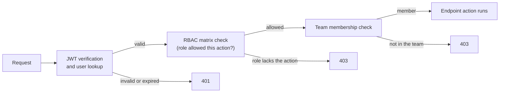
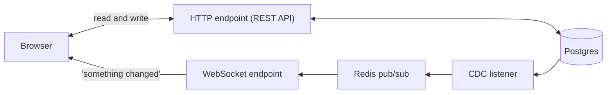
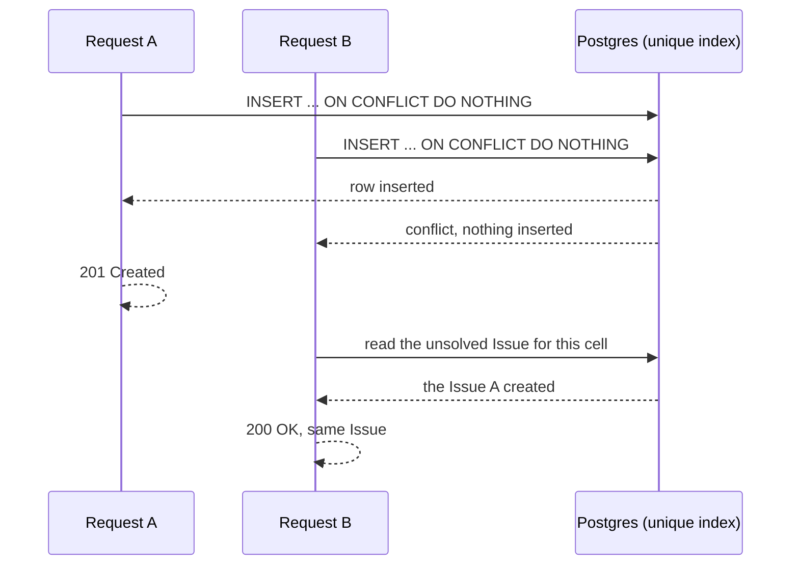
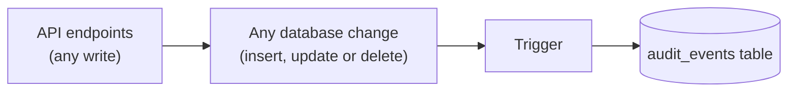

# Level 10 Meeting

A weekly team-meeting app: a Scorecard of Measurables, Rocks, Issues and To-Dos, and a live meeting that
several people attend at once. FastAPI + Postgres + Redis behind nginx, with a React front end.

## Preface

This README is the guide to running, testing and understanding the app. It starts with how to bring the whole stack
up with one command and how to run every test with another. It then explains the main design decisions: how the API
is organised, how every request is secured, how meetings stay in sync across browsers, and how changes are audited.
The last two sections are the reference material that came with the assessment: the seed data and the format of the
rules report.

## Contents

1. [Start the infrastructure](#start-the-infrastructure)
2. [Run the tests](#run-the-tests)
   - [3 layers of testing](#3-layers-of-testing)
     - [Unit testing](#unit-testing)
     - [API testing](#api-testing)
     - [E2E testing](#e2e-testing)
   - [Fixture and clock strategy](#fixture-and-clock-strategy)
   - [Run all three at once](#run-all-three-at-once)
   - [Continuous integration (run all tests in CI)](#continuous-integration-run-all-tests-in-ci)
3. [Decision record](#decision-record)
   - [API design](#api-design)
   - [How requests are secured](#how-requests-are-secured)
   - [Real-time sync](#real-time-sync)
   - [Concurrency control](#concurrency-control)
   - [Audit trail](#audit-trail)
4. [About the seed data](#about-the-seed-data)
5. [Rules report format](#rules-report-format)

## Start the infrastructure

You need Docker (with Compose). From the repository root:

```bash
docker compose up -d --build --wait
```

This builds and starts four containers and waits until each is healthy:

| Service | What it is | Reachable at |
|---|---|---|
| `db` | Postgres 16 (migrations and the seed run when the API starts) | `localhost:5432` |
| `redis` | Redis 7, the fan-out for live meeting updates | internal only |
| `api` | FastAPI app | internal only, through nginx |
| `web` | nginx: serves the React app and forwards `/api` to the API | http://localhost:8080 (https://localhost:8443, self-signed) |

Then open http://localhost:8080 and sign in with a seeded email, for example `avery@acme.test` (Admin),
`blake@acme.test` (Team Member) or `ellis@acme.test` (Observer). The API docs are at http://localhost:8080/api/docs.

The server clock is pinned to the seed's "now" (`APP_NOW`, 2026-11-11T15:00:00Z) in `docker-compose.yml`, so
the data and the statuses are the same on every run.

```bash
docker compose down        # stop
docker compose down -v     # stop and delete the database volume: the next start is a freshly seeded database
```

## Run the tests

### 3 layers of testing

The tests are in three layers, each with its own script. The unit script needs nothing. The API and end-to-end
scripts assume the infrastructure is already up (`./scripts/test.sh` starts it, or run
`docker compose up -d --build --wait` yourself) and print how to start it if it is not. Extra arguments go to the
test runner, so you can run a single test.

#### Unit testing

Script: `./scripts/test-unit.sh`. No database and no network. These check the business rules directly, each with its boundary cases: Measurable status
(`tests/unit/test_measurable_status.py`), Rock status and progress, the To-Do completion rate and its rounding, the
role-by-action access matrix, and the clock. The services and controllers are tested next to them with their
collaborators faked. Runs in seconds. Example: `./scripts/test-unit.sh -k rock`.

#### API testing

Script: `./scripts/test-api.sh`. Real HTTP requests into the real FastAPI app, with a real signed-in user. Needs
Postgres. Together they prove:

- *Access control:* a Team Member reading another team's data is refused, an Observer's write is refused (`tests/api`).
- *Data visibility and team isolation:* the queries that decide who sees what, run against the seeded database (`tests/api_db`).
- *Concurrency:* simultaneous Make it an Issue requests for the same Measurable and week return one Issue; the
  extra requests get the existing one back (`tests/api_concurrency`).
- *The SQL itself, on the seed:* queries, constraints, the append-only audit trail, and the meeting summaries for
  the two seeded meetings (`tests/repository`).

The tests create and drop their own databases (`l10_test`, `l10_concurrency`) on the same Postgres, so your dev
data is never touched. Example: `./scripts/test-api.sh tests/api_concurrency -v`.

#### E2E testing

Script: `./scripts/test-e2e.sh`. One Playwright test, two browsers, the whole stack through nginx. Blake signs in and starts a meeting. Casey signs in
afterwards, sees **Join meeting** (not Start), and joins. Blake advances the agenda; Casey's page follows on its own,
with no reload. It ends the meeting when it finishes, so it can be run again on the same stack. Playwright saves a
trace of every run in `client/test-results/`, and the HTML report in `client/playwright-report/`; open a trace with
`npx playwright show-trace <path>/trace.zip`. A trace of a failing run (Redis stopped, so the second browser cannot
follow) is kept in `client/e2e/artifacts/failure-trace-no-redis.zip`.

### Fixture and clock strategy

- **Clock.** Business time never comes from the system clock. It comes from `APP_NOW`, pinned to the seed's "now"
  (2026-11-11T15:00:00Z, company time America/Chicago) by the test setup (`server/tests/conftest.py`) and, for the
  end-to-end test, by `docker-compose.yml`. The current week, the 13-week window and overdue To-Dos are therefore
  the same on every run, on any day. Unit tests build a clock at any instant they need to hit a boundary. Only token
  expiry and live meeting timestamps use the real clock, on purpose.
- **Fixture.** Tests start from the real `seed.json`, loaded into a Postgres built from the real migrations, in
  databases of their own (`l10_test`, `l10_concurrency`), never the dev one. The shared API tests load the seed once and
  roll back each test's writes. The concurrency tests need real commits, so they get a throwaway database. The
  end-to-end test runs on the freshly seeded stack and ends the meeting it starts (and one left by an aborted run), so
  it can be run again.

### Run all three at once

One command starts the infrastructure (see above), then runs the unit, API and end-to-end tests in that order, and
stops at the first failure:

```bash
./scripts/test.sh
```

By default the browser test is **headless**, so the command runs unattended. To watch it instead, set `HEADED=1`:

```bash
HEADED=1 ./scripts/test.sh
```

Headed mode opens two real browser windows side by side (Blake on the left, Casey on the right), draws a red
cursor that glides to each button with a ripple on every click, and pauses after each step. Tune it with:

| Variable | Default | Meaning |
|---|---|---|
| `HEADED` | unset (headless) | `1` opens the browser windows |
| `STEP_DELAY_MS` | `2000` | pause after each step, headed only |
| `SCREEN_WIDTH`, `SCREEN_HEIGHT` | `1440`, `900` | your display size, used to split the screen in half |

For example: `HEADED=1 STEP_DELAY_MS=4000 SCREEN_WIDTH=1728 ./scripts/test.sh`.

### Continuous integration (run all tests in CI)

`.github/workflows/tests.yml` runs all the tests in CI, the unit, API and end-to-end layers, by calling
`./scripts/test.sh` on every push and pull request (and on demand from the Actions
tab), so nobody has to run anything locally to see the result. The browser test runs headless there. The Playwright
report and traces are uploaded as the `playwright-report` artifact of each run, and the container logs are printed if
a run fails.

## Decision record

The five decisions the brief leaves open (2.8), each with what I chose and what it costs. The five sections after
them (API design, how requests are secured, real-time sync, concurrency control, audit trail) are the detail behind decisions 2 to 4.

**1. Data model.** One table per entity (users, teams and memberships, measurables, scores, issues, to-dos,
milestones, rocks, meetings, attendees, ratings, section timings), in Postgres, with the rules as constraints. A
score is one row per measurable and week, so "last save wins" is a plain upsert. An Issue links to its source with
two nullable columns, `source_measurable_id` and `source_week_start`, and a To-Do links to its Issue with
`source_issue_id`; both also record the meeting they came from or were solved in (`created_in_meeting_id`,
`solved_in_meeting_id`). Links are real foreign keys, not copies of text, so a title edit shows everywhere.
*Tradeoff:* an Issue made from a score keeps pointing at the measurable and week even after the score changes, and
computed values (status, averages, overdue) are never stored; they are derived from the data and the clock on every
read, which keeps them correct at any date but costs a little work per request.

**2. API design.** One module per resource, one endpoint per action, and a different visibility scope is a
different action (`/api/teams/{id}/issues` for your team, `/api/admin/teams/{id}/issues` for any team). Each endpoint
checks its role against the RBAC matrix before doing anything else. See [API design](#api-design) and
[How requests are secured](#how-requests-are-secured). *Tradeoff:* more routes and a matrix to keep complete, in
return for access rules you can read in one table; a wiring test fails if a team route has no admin twin.

**3. Real-time transport, and who owns meeting state.** Postgres owns the state: the current section and when it
started are columns on the meeting, and the timer is derived from them, so nothing lives only in a server process
or a browser. Changes reach browsers by database trigger, Postgres `NOTIFY`, Redis pub/sub and a WebSocket that
says only "something changed"; the browser refetches over REST. A socket that drops simply reconnects and refetches
everything, so recovery needs no replay. See [Real-time sync](#real-time-sync). *Tradeoff:* one extra round trip per
change, and a change made while the listener is down shows only at the next reconnect, in return for a protocol
that cannot disagree with the database. Presence counts live in the API process, so more than one worker would need
them in Redis.

**4. Make it an Issue without duplicates.** The database enforces it, not the application: a partial unique index
`uq_issue_unsolved_per_source` on `(source_measurable_id, source_week_start)` where the Issue is unsolved. The
service inserts with `ON CONFLICT DO NOTHING`, and if nothing was inserted it returns the existing Issue (201 when
created, 200 when returned). Concurrent requests therefore cannot create two, whatever the timing, and a solved
Issue frees the slot for a new one. *Tradeoff:* a check-then-insert in code is simpler to read but races; the index
costs one small index and a migration, and is proven by a test that fires three requests at once against real,
separately committed transactions.

**5. Keeping past meeting summaries unchanged.** Today a summary is assembled from the live data when it is
requested, so a later edit to a score or an Issue would change an old summary. To freeze it, I would write the
assembled summary as a JSON snapshot in a `meeting_summaries` row in the same transaction that ends the meeting,
and serve that row afterwards. *Tradeoff:* a snapshot is exact and cheap to read but duplicates data and can't be
corrected without a deliberate write; the alternative of replaying the audit trail to the meeting's end time needs no
new table but is slower and harder to get right. This is described, not built.

### API design

The API is organised so that the answer to "who can do this?" can be read off one list, and so that the default
can never leak data across teams.

**1. One router per resource.** Each resource (team, measurable, score, rock, milestone, issue, to-do, meeting)
has its own module with its own router, use case, service and repository, and its routes live under that
resource's path. For example:

- `/teams/{team_id}/issues`
- `/issues/{issue_id}/solve`

A change to Issues touches the Issue module and nothing else. Derived views that are not resources of their own (the
meeting summary, the audit trail, the realtime socket) are modules too, so they never grow into the resource they
read from.

**2. One endpoint per action.** An endpoint does exactly one thing and maps to exactly one named action in
`core/permissions.py`. For example:

- `EDIT_SCORE`
- `SET_ISSUE_PRIORITY`
- `SOLVE_ISSUE`
- `ADVANCE_MEETING`

There are no "update anything" endpoints that decide what to allow from the body, so an endpoint's permission never
depends on what the caller sends.

**3. A different visibility scope is a different action.** Every action defaults to the narrowest scope: it works
only in a team the caller belongs to. Reaching other teams is not a flag on that endpoint. It is a separate action
with its own endpoint, held only by Admins, and the endpoint is the one that decides what is visible:

| Action | Endpoint | Visibility scope |
|---|---|---|
| `LIST_ISSUES` | `GET /api/teams/{team_id}/issues` | Issues of that team, and only if the caller is a member of it |
| `ANY_TEAM_LIST_ISSUES` | `GET /api/admin/teams/{team_id}/issues` | Issues of any one team, no membership needed (Admin only) |
| `SOLVE_ISSUE` | `POST /api/issues/{issue_id}/solve` | Only an Issue of a team the caller belongs to |
| `ANY_TEAM_SOLVE_ISSUE` | `POST /api/admin/issues/{issue_id}/solve` | An Issue of any team (Admin only) |
| `LIST_MY_TEAMS` | `GET /api/teams` | Only the caller's own teams |
| `LIST_ALL_TEAMS` | `GET /api/teams/all` | Every team in the company (Admin only) |
| `LIST_USERS` | `GET /api/users` | People who share a team with the caller |
| `LIST_ALL_USERS` | `GET /api/users/all` | Everyone in the company (Admin only) |

Every team-scoped action has an `ANY_TEAM_` twin under `/api/admin`. A test requires every team-scoped route to
have an admin twin and checks that each one calls its own method, so a route cannot quietly gain wider reach.

**4. Every endpoint checks the caller's role against its action.** The matrix maps each role to the set of
actions it may perform, and anything not listed is denied (Observers read, Team Members read and write, Admins
do everything). The first line of every use case is `rbac.require(actor, Action.X)`. For the narrow actions a
second check, team membership, follows. Rules that depend on the particular meeting are checked in the meeting
service, because the role alone cannot decide them. For example:

- only the facilitator advances or ends the meeting
- only an attendee rates it

**Inputs and responses.** Request bodies and parameters are validated at the API, and errors use consistent status
codes. For example:

- a score's `week_start` must be a Monday inside the 13-week window, otherwise 422
- 403 for a refused role or team, 404 for a missing resource, 409 for a conflict
- Make it an Issue returns 201 when it created the Issue and 200 when it returned the existing one

**How it is proven.** The role-by-action matrix is unit-tested, access control is tested through real HTTP
requests as each role, data visibility is tested against the seeded database, and the route-wiring test above
guards the scope split.

### How requests are secured

Every request passes four steps, in this order, before any data is read or changed. A failure at any step stops
the request with an error and nothing is touched.

1. **Verify the JWT before the handler runs.** Each route depends on `get_current_user`
   (`core/auth.py`), a FastAPI dependency, so it runs ahead of the handler body. It reads the
   `Authorization: Bearer` header and verifies the token: the signature against `JWT_SECRET`, only the
   configured algorithm, the expiry, and that the `sub` and `exp` claims are present. A missing, malformed,
   tampered or expired token gets **401**.
2. **Resolve the user and put it in the request context.** The user id in the token's `sub` claim is looked up in
   the database on every request, so a user who was removed loses access at once, even with a valid token. The
   resulting `User` is handed to the handler as `actor`. The same user id is also written to the request's
   database transaction (`app.actor_id`), which is how the audit trail records who made each change.
3. **Check the role against the action.** The handler passes `actor` to its use case, whose first line is
   `rbac.require(actor, Action.X)`. The action is the one this endpoint performs, and a role that does not have it
   gets **403**. For team-scoped actions a second check follows: the caller must be a member of the team in the
   URL, otherwise **403**. Only the `/api/admin` endpoints skip the membership check, and only Admins hold those
   actions.
4. **The RBAC matrix is a map from role to allowed actions** (`core/permissions.py`). Observer, Team Member and
   Admin each list exactly the actions they may perform, and anything not listed is denied. The checker is one
   pure function, `role_can(role, action)`, which knows nothing about users or teams, so the matrix is unit-tested
   on its own.



Sign-in is by email only, with no password, because the seed has none. The token is signed with `JWT_SECRET`, whose
default in `docker-compose.yml` is a development value and must be replaced in production.

### Real-time sync

Meeting attendees see each other's changes live. There are two separate paths between the browser and
the database, around the one Postgres: the HTTP path carries the data, the WebSocket path only carries "something changed".



In words:

1. **Reading and writing always goes over HTTP.** `browser <> HTTP endpoint <> Postgres`. Every read and every write is
   a normal REST call with the usual login, role and team checks.
2. **The WebSocket never carries data**, only the news that something changed:
   `browser <> WebSocket endpoint <> Redis pub/sub <> CDC listener <> Postgres`.
3. **When someone writes** (say the facilitator advances the agenda): the write goes in over HTTP and Postgres commits
   it. A trigger in Postgres sends a notification (that is the change capture, the "CDC"). The CDC listener hears it
   and publishes it to Redis on the channel `team:{id}`. Redis hands it to every WebSocket endpoint subscribed to that
   team, and each one tells its browser `{"type": "change", "kind": "meeting"}`.
4. **The other browser reacts** by asking the HTTP endpoint for the changed data. That read is checked like any
   other read.
5. **Connecting.** A browser opens the WebSocket, sends its login token as the first message, is checked for
   membership in the team, subscribes to the team's Redis channel, and gets `ready`. It then fetches everything once.

- **Capture in the database.** Row triggers on `scores`, `measurables`, `issues`, `todos`, `meetings`,
  `meeting_attendees`, `meeting_ratings` and `meeting_sections` call `pg_notify` with `{team_id, kind}`. Postgres
  delivers a NOTIFY only when the transaction commits, so a rolled-back write is never announced, and it fires for
  any writer (the API, the seed script, psql), not only for code that remembered to publish.
- **Two hops.** The listener (`forward_changes`, one task per API process) turns each NOTIFY into a Redis
  `PUBLISH` on `team:{id}`. Redis lets every API worker serve its own sockets, not just the worker that took the write.
- **Events carry no data**, only what kind of thing changed. The browser refetches through the REST API, so every
  read still goes through authentication, the role check and the team scope. A socket can never reveal anything a
  REST call would refuse.
- **Catching up.** The socket subscribes to Redis before it sends `ready`, and the browser refetches everything on
  every (re)connect, so a dropped socket cannot leave it stale. Events are not replayed: a change that happens
  while the listener is down is missed by the live feed, and the page shows it at the next reconnect, refocus or
  navigation.
- **The WebSocket is the attendance.** A user is in a meeting while a socket on `/ws/teams/{id}/meeting` is open;
  their last socket closing leaves it. Only the Meeting page opens this socket. The Team page opens none, so a
  team with nobody in a meeting produces no live traffic, at the price that an open Team page, or the "find a meeting"
  page, refreshes on focus and navigation, not on its own.
- **Limit.** The open-socket counts behind presence live in the API process, so more than one API worker would
  need them moved to Redis.

### Concurrency control

The brief asks for one thing here: concurrent Make it an Issue requests for the same score must produce one Issue.
Everything else (scores, To-Dos, ratings) is "last save wins", and Postgres makes each of those writes atomic.

**The rule.** For one measurable and one week there may be at most one *unsolved* Issue. Once it is solved, a new
one may be made for the same cell.

**The guarantee lives in the database.** A composite partial unique index:

```sql
CREATE UNIQUE INDEX uq_issue_unsolved_per_source
    ON issues (source_measurable_id, source_week_start)
    WHERE solved_at IS NULL AND source_measurable_id IS NOT NULL;
```

- The key is the pair `(source_measurable_id, source_week_start)`: which measurable, and the Monday of the score's
  week (not the day the Issue was made).
- The `WHERE solved_at IS NULL` part is what makes it *partial*. Solved Issues are outside the index, so they never
  block a new Issue for the same cell, and any number of them can exist.
- Issues not made from a score (`source_measurable_id` is null) are outside the index too.

**How the code uses it.** The insert is `INSERT ... ON CONFLICT DO NOTHING RETURNING id`. If a row comes back, this
request created the Issue and answers 201. If nothing comes back, another request got there first (or the Issue
already existed), so the code reads the existing unsolved Issue and answers 200 with it.



**Why not check first, then insert.** A lookup followed by an insert in code leaves a gap: two requests both see
"none" and both insert. The index closes the gap because Postgres decides the winner when the row is written, and the
loser's insert waits for the winner's transaction instead of failing the request. Even without `ON CONFLICT`, the
second insert would be rejected with a unique violation; `DO NOTHING` just turns that rejection into a normal path
we can answer from.

**Cost.** One small index and a migration, a failed insert attempt on the losing request, and no application locks
or retries to maintain.

**How it is tested.** `server/tests/api_concurrency/test_make_it_an_issue.py` fires three requests at the same
instant (a barrier releases the threads together) against a throwaway database with real, separately committed
transactions, which the rolled-back API tests cannot give. It asserts one 201 and two 200s, one shared Issue id and
exactly one row. A second test solves the Issue and asserts that a new request then creates a different Issue.

### Audit trail

Every change to scores, issues, to-dos and meetings is recorded in the `audit_events` table by a database trigger.
That is what makes concurrent updates auditable: if two people overwrite each other, the table shows who changed
what, in which order, and what the row held before and after.



- **Written by the database, in the same transaction.** If the write commits its audit row commits with it, and if it
  rolls back they vanish together. Nothing depends on a listener being up (unlike the NOTIFY path, which can lose
  events while disconnected), and the payload has no size limit. Writes made outside the API are covered too.
- **Who did it.** The API sets the transaction-local setting `app.actor_id` to the authenticated user, and the
  trigger copies it into the row.
- **Append-only, enforced by the database.** Triggers on `audit_events` refuse `UPDATE`, `DELETE` and `TRUNCATE`.
  An `UPDATE` that changes nothing is not recorded.
- **Read access** is one admin-only endpoint, `GET /api/audit-events`. There is no screen for it.

## About the seed data

- "Now" for the seed is **2026-11-11T15:00:00Z** (Wednesday, November 11, 2026, 9:00 AM Chicago). Your app reads "now" from `APP_NOW` and defaults to this value.
- The company time zone is America/Chicago. All timestamps in the file are UTC.
- Weeks are named by their Monday in company time (`week_start`), for example `2026-11-02`.
- Dates without a time (`due_date`) are calendar dates in company time.
- `source` on an Issue links it to a Measurable and week. `source_issue_id` on a To-Do links it to an Issue.
- The two meetings in `meetings` have already ended. Their summaries are part of the rules report.
- Keep the ids from `seed.json` (`u1`, `m1`, `t12`, ...). The rules report is keyed by them.

## Rules report format

Your rules report command prints this JSON for the current `APP_NOW`, computed on a freshly seeded database (no data added while testing). We will also run it at other dates, so compute every value from the data.

- Include every team, and every Measurable with all 13 weeks ending with the current week (Aug 17 to Nov 9 at the default `APP_NOW`).
- Include every one of those weeks in `todo_completion`. A week with nothing due is `null`.
- "Today" (for overdue To-Dos and past-due Milestones) is the date of `APP_NOW` in company time.
- Status values are `on_track`, `off_track` or `pending`. Rock status is `on_track`, `off_track` or `complete`.
- Percentages are whole numbers, rounded half up. Ratings have one decimal, rounded half up.
- Lists of ids are sorted as plain strings (`t12` before `t30`), except `issue_order`, which lists unsolved Issues in Issue order.
- `meetings` covers ended meetings, keyed by meeting id. `scorecard_week` is the week the meeting reviewed. `rating` is `null` if no one rated.

```json
{
  "now": "<APP_NOW, ISO 8601 UTC>",
  "teams": {
    "<team_id>": {
      "measurable_status": {"<measurable_id>": {"<week_start>": "on_track | off_track | pending"}},
      "todo_completion": {"<week_start>": "null, or {due, done, rate_percent, meets_target}"},
      "overdue_todos": ["<todo_id>"],
      "rocks": {"<rock_id>": {"status": "on_track | off_track | complete", "progress_percent": 0}},
      "issue_order": ["<issue_id>"],
      "meetings": {
        "<meeting_id>": {
          "scorecard_week": "<week_start>",
          "measurable_status": {"<measurable_id>": "on_track | off_track | pending"},
          "issues_solved": ["<issue_id>"],
          "todos_created": ["<todo_id>"],
          "attendee_ids": ["<user_id>"],
          "rating": "number with one decimal, or null"
        }
      }
    }
  }
}
```

A `todo_completion` week that has To-Dos due looks like this:

```json
{"due": 4, "done": 3, "rate_percent": 75, "meets_target": false}
```

`meets_target` compares the exact ratio with 90%, not the rounded percent.
